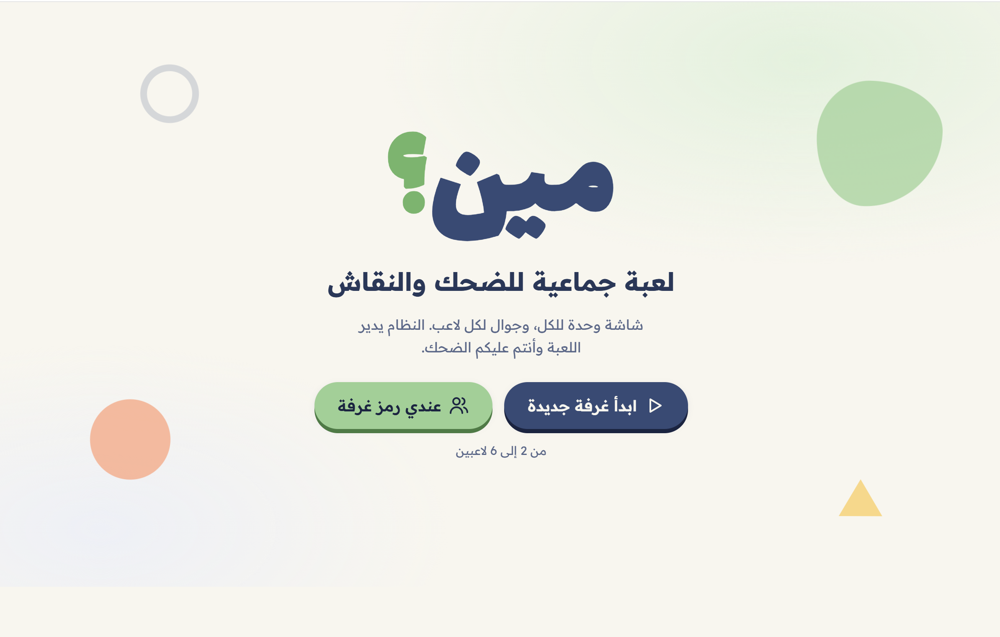

# Meen? | Interactive Multiplayer Party Game 🎮

**A real-time multiplayer party game designed for social gatherings.**

Meen? (مين؟) is a browser-based game where players join from their phones, answer questions through writing or drawing, and reveal their answers on a shared screen.

The project was developed as a commercial digital product for **By Noha**, with a focus on creating a simple, engaging, and accessible multiplayer experience.

## Project Overview

- **Platform:** Web application
- **Type:** Real-time multiplayer party game
- **Players:** 2–6
- **Status:** Developed and deployed
- **Development:** AI-assisted software development

## Key Features

- Real-time multiplayer rooms
- Mobile-based player participation
- Text and drawing responses
- Shared game board
- Customizable rounds and timers
- Different question distribution modes
- Automatic answer reveals
- Activation code system

## Technologies

- JavaScript / TypeScript
- HTML & CSS
- Cloudflare Workers
- Cloudflare Durable Objects
- Git & GitHub

## My Role & Contributions

As the project creator, I was responsible for:

- Defining the game concept and functional requirements.
- Planning the user experience and gameplay flow.
- Making interface and design decisions.
- Testing features and identifying bugs.
- Reviewing and validating fixes.
- Coordinating deployment and preparing the product for release.

**AI-Assisted Development:** Claude Code generated most of the implementation code under my direction. My primary contributions focused on product planning, UX decisions, iterative testing, quality assurance, and deployment coordination.

## Development Challenges

Some of the key challenges addressed during development included:

- Managing real-time multiplayer game sessions.
- Keeping the game board and player devices synchronized.
- Preventing previous answers and drawings from appearing in new rounds.
- Creating a smooth experience across desktop and mobile devices.
- Managing activation codes without exposing sensitive credentials.

## Screenshots

### Game Home

### Multiplayer Board

### Player Experience

### Answer Reveal

## Live Website

[View Meen? Game](https://meen.bynoha-4.workers.dev)

*Creating a game room requires a valid activation code.*

## Source Code

The complete source code is maintained in a private repository because this is a commercial product.

This public repository is intended to showcase the project's features, development process, and my contributions.
